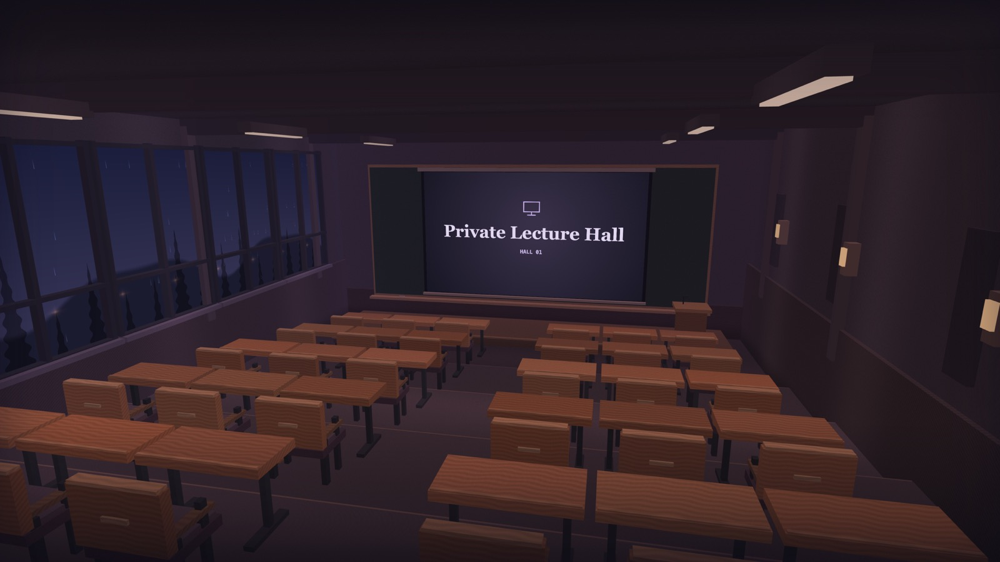

# Private Lecture Hall · 私人阶梯教室

走进一间 3D 阶梯教室，挑个座位，把视频放上幕布，邀请朋友一起看。

[在线体验](https://lecturehall.cn/) · [使用教程](docs/USAGE.zh-CN.md) · [部署教程](docs/DEPLOY.zh-CN.md) · [English](README.en.md)

## 功能

- 原生 WebGL 教室，座位视角、幕布透视和桌椅遮挡。
- 简体中文和英文切换，记住本机选择。
- 公开大厅、私密邀请、30 个座位、人物占座、文字聊天和消息气泡。
- 灯光、雨声、示例课程、视频链接、MP4/WebM 上传。
- Node.js + SQLite 保存联机状态、上传文件和匿名访问统计。

## 快速开始

安装 Node.js 24 或更高版本，无第三方 npm 依赖。

    npm run build
    npm start

打开 http://localhost:8787，使用两个不同浏览器测试联机。

    npm test

Docker 和 systemd 部署方法见 [部署教程](docs/DEPLOY.zh-CN.md)。这是常驻后端项目，需要持久磁盘。

## 视频范围

YouTube、内置示例和兼容的视频文件支持同步播放。B 站、抖音、腾讯视频、优酷使用官方外链播放器，由观众各自控制进度。小红书公开页解析在部分服务器出口仍有失败反馈。各来源受网络、编码、跨域和平台权限影响，详见使用教程。

## 统计和隐私

统计自动启用，使用 localStorage 保存匿名浏览器 ID。每次页面加载记录一次访问，累计页面前台停留时间，包含大厅和教室。按北京时间汇总，清除存储、换浏览器或设备会重复计数，关闭浏览器可能丢失最后一段上报。部署者应按自己的实际需求设置用户说明与选择机制。

统计查询脚本位于 server/usage-report.mjs，当前没有网页管理后台。项目使用临时访客昵称身份，适合小范围试用。房间约每 1.2 秒同步，单实例 SQLite 存储，不支持横向扩展。

## 目录

| 目录 | 内容 |
|---|---|
| public/ | 双语界面、WebGL、播放、聊天和统计脚本 |
| worker/ | 业务处理、链接解析和构建脚本 |
| server/ | Node 服务、上传、统计与报表 |
| drizzle/ | 数据库迁移 |
| deploy/ | Caddy、systemd 和环境变量模板 |
| tests/ | 联机、解析和 HTTP 上传测试 |

## 许可证

原创代码采用 [MIT](LICENSE)，第三方资源见 [THIRD_PARTY_NOTICES.md](THIRD_PARTY_NOTICES.md)。视频平台内容保留原有权利。
